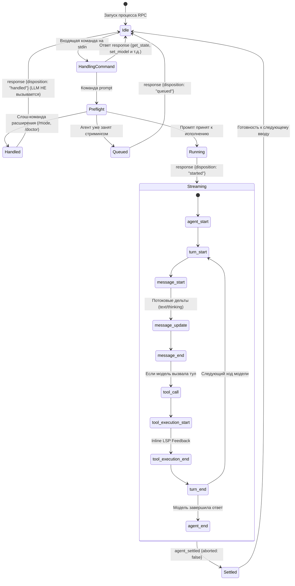

# Полная спецификация и руководство по протоколу RPC (stdin/stdout) ПерУН (PerUN / Pi)

Данный документ представляет собой исчерпывающую техническую спецификацию протокола RPC (stdin/stdout) для интеграции внешних клиентов — сред разработки (IDE, 1C:EDT, VS Code), внешних UI, веб-сервисов, оркестраторов процессов и автономных ИИ-агентов — с кодинг-агентом и специализированным расширением **ПерУН** (Персональный Умный Напарник для 1С).

---

## 1. Архитектура и процессная модель

ПерУН функционирует как автономный долгоживущий дочерний процесс (subprocess), полностью управляемый через стандартные дескрипторы ввода-вывода OS (`stdin`, `stdout`, `stderr`).

```
+---------------------------------------------------------------------------------+
|                                 ВНЕШНИЙ КЛИЕНТ                                  |
|                 (IDE Плагин, Веб-сервер, Автономный ИИ-Оркестратор)             |
+---------------------------------------------------------------------------------+
        |                                      ^                         ^
  stdin | Команды (JSONL)                      | stdout                  | stderr
        | Ответы UI (JSONL)                    | Ответы, События, UI     | Текстовые логи,
        v                                      | Запросы (JSONL)         | трейсы ошибок
+---------------------------------------------------------------------------------+
|                             ПРОЦЕСС ПЕРУН (perun)                               |
|                                                                                 |
|  +---------------------------------------------------------------------------+  |
|  |                             ЯДРО АГЕНТА (Pi Core)                         |  |
|  |  - Цикл диалога (Agent Loop)       - Сессионный менеджер (SessionManager) |  |
|  |  - Подключение к LLM (ModelRuntime) - Исполнитель команд Bash (BashExecutor)|  |
|  |  - Управление контекстом (Compact)  - Механизм расширений (ExtensionRunner) |  |
|  +---------------------------------------------------------------------------+  |
|                                       ^                                         |
|                                       | Хуки жизненного цикла и событий         |
|                                       v                                         |
|  +---------------------------------------------------------------------------+  |
|  |                         МОДУЛЬ 1C: ПЕРУН (1c-agent)                       |  |
|  |  - Менеджер режимов (ModeManager: НАЙТИ, ОБЪЯСНИТЬ, НАПИСАТЬ, ПЛАНИРОВАТЬ) |  |
|  |  - Политика прав (PermissionManager: strict, auto-approve, yolo)          |  |
|  |  - LSP демон (bsl-analyzer): автопроверка BSL/OS и Inline Feedback         |  |
|  |  - 1С Инструменты: 1c_vanessa, bsl_fix_standards, 1c_impact_analysis     |  |
|  |  - Анализ графа: 1c_call_hierarchy, 1c_ast_symbols                        |  |
|  |  - Субагенты: 1c_subagent (architect, coder, tester, reviewer)           |  |
|  |  - Библиотека навыков 1С (82 встроенных навыка)                           |  |
|  +---------------------------------------------------------------------------+  |
+---------------------------------------------------------------------------------+
```

### 1.1. Способы запуска процесса

В зависимости от среды запуска и сборки форка доступны следующие варианты вызова:

1. **Нативный бинарный файл PerUN (компиляция через Bun):**
   ```bash
   ./packages/1c-agent/bin/perun --mode rpc [опции]
   ```
2. **ESM-бандл Node.js:**
   ```bash
   node ./packages/1c-agent/bin/perun.bundle.mjs --mode rpc [опции]
   ```
3. **Запуск через npm/bun из корня репозитория:**
   ```bash
   npm run perun -- --mode rpc [опции]
   ```

### 1.2. CLI-параметры запуска

| Флаг | Тип | Обязательный | Значение по умолчанию | Описание |
|---|---|---|---|---|
| `--mode rpc` | флаг | **Да** | `interactive` | Активирует режим JSONL-ввода/вывода на `stdin`/`stdout`. |
| `--no-session` | флаг | Нет | `false` | Режим сессии в памяти. Файл истории `.jsonl` не создается на диске. |
| `--session <path\|id>` | строка | Нет | `null` | Открывает существующую сессию по абсолютному/относительному пути или ID. |
| `--session-dir <dir>` | путь | Нет | `~/.local/share/pi/sessions/` | Директория для хранения файлов сессий. |
| `--provider <name>` | строка | Нет | из настроек | Идентификатор LLM-провайдера (`anthropic`, `openai`, `google`, `ollama` и др.). |
| `--model <id>` | строка | Нет | из настроек | Идентификатор модели (например, `claude-3-7-sonnet-20250219`). |
| `--thinking <level>` | строка | Нет | `off` | Уровень рассуждений модели: `off`, `minimal`, `low`, `medium`, `high`, `xhigh`, `max`. |
| `--name <name>` | строка | Нет | `null` | Устанавливает начальное имя сессии. |
| `--cwd <path>` | путь | Нет | текущий каталог | Рабочая директория проекта (корень проекта 1C:EDT). |
| `--no-tools` | флаг | Нет | `false` | Отключает все инструменты агента (режим чистого чата). |
| `--tools <list>` | строка | Нет | все | Список разрешенных инструментов через запятую. |
| `--exclude-tools <list>` | строка | Нет | пусто | Список исключаемых инструментов через запятую. |
| `--offline` | флаг | Нет | `false` | Отключает проверку обновлений и внешние сетевые каталоги. |

> **КРИТИЧЕСКОЕ ПРАВИЛО ДЛЯ ИИ-АГЕНТОВ**:
> Аргументы позиционного промпта вида `perun --mode rpc "текст"` или `@file` **запрещены**. Любое взаимодействие с моделью и передача промптов/файлов выполняются исключительно через команду `prompt` на потоке `stdin` после успешного старта процесса.

### 1.3. Переменные окружения

| Переменная | Назначение |
|---|---|
| `APP_NAME` | Автоматически выставляется в `"perun"` скриптом запуска. |
| `PI_SESSION_DIR` | Переопределяет директорию хранения сессий. |
| `VRUNNER_PATH` | Явный путь к утилите `vrunner` для запуска Vanessa Automation. |
| `OSCRIPT_PATH` | Явный путь к интерпретатору `OneScript` (`oscript`). |
| `BSL_ANALYZER_PATH` | Явный путь к нативному бинарнику `bsl-analyzer` (если не используется встроенный). |
| `PI_OFFLINE` | Флаг принудительной работы без сети (`"1"`). |

---

## 2. Транспортный уровень и фрейминг (Framing)

### 2.1. Строгий протокол JSONL
- **Формат:** Строковый JSON Lines. Каждая протокольная запись представляет собой **однострочный JSON-объект**, завершающийся строго символом `\n` (LF, ASCII-код `0x0A`).
- **Символы возврата каретки:** Записи могут содержать `\r\n` (CRLF) на стороне входа `stdin`. Парсер агента отсекает предшествующий `\r`.
- **Сепараторы Unicode:**
  > [!WARNING]
  > Стандартная реализация `readline` во многих языках (включая Node.js `readline`) трактует спецсимволы Unicode `U+2028` (Line Separator) и `U+2029` (Paragraph Separator) как границы строк. В исходном коде BSL или генерациях LLM эти символы могут присутствовать внутри строковых литералов JSON. Парсинг стандартным `readline` разорвет JSON-строку и приведет к фатальной ошибке парсинга.
  > **Требование к клиенту:** разделять поток байтов исключительно по байту `0x0A` (`\n`).

### 2.2. Изоляция потоков ввода-вывода
- `stdin` **(Только входящие команды):** Принимает команды клиента (`RpcCommand`) и ответы на запросы диалогов UI (`RpcExtensionUIResponse`).
- `stdout` **(Строго протокольные JSONL-записи):** В `stdout` запрещен любой неструктурированный текст. Здесь передаются только три семейства JSON-объектов:
  1. Ответы на команды (`type: "response"`).
  2. События сессии (`type: "agent_start"`, `"message_update"`, `"tool_execution_end"` и т.д.).
  3. Запросы расширений к пользовательскому интерфейсу (`type: "extension_ui_request"`).
- `stderr` **(Диагностика и системные логи):** Сюда выводятся отладочные сообщения, стек-трейсы и информационные логи компонентов. Парсить `stderr` как протокольные данные категорически запрещено.

### 2.3. Механизм противодавления (Backpressure)
Процесс агента контролирует заполнение буфера вывода `stdout` через `waitForRawStdoutBackpressure()`. Если клиент перестает вычитывать `stdout`, сокет заполнится, и агент приостановит исполнение модели и инструментов. Клиент обязан организовать постоянное асинхронное чтение `stdout`.

---

## 3. Модель корреляции, стейт-машина и жизненный цикл

### 3.1. Корреляция команд и ответов по `id`
Каждая команда, отправляемая в `stdin`, может содержать строковый идентификатор `"id"` (например, UUID или автоинкрементный счетчик):

```json
{"id": "req_101", "type": "get_state"}
```

Ответ агента обязательно возвращает переданный `id`:
```json
{"id": "req_101", "type": "response", "command": "get_state", "success": true, "data": {...}}
```

> **Правило клиента:** Обработка команд агентом асинхронна. Несколько команд могут выполняться с разной скоростью. Сопоставлять ответ с запросом необходимо **строго по полю `id`**, а не по очередности поступления строк в `stdout`.

### 3.2. Стейт-машина исполнения промпта



### 3.3. Семантика поля `disposition` команды `prompt`

Ответ `response` на команду `prompt` свидетельствует только о результате первичной валидации (preflight):

| Значение `disposition` | Что произошло | Нужно ли ждать `agent_settled`? |
|---|---|---|
| `"started"` | Промпт успешно запущен в работу. Модель начинает генерацию. | **Да, обязательно.** Ожидайте события `agent_settled`. |
| `"queued"` | Промпт поставлен в очередь `steer` или `followUp`, так как агент уже был занят. | **Нет.** Промпт будет исполнен позже в рамках текущего или следующего цикла. |
| `"handled"` | Команда была перехвачена и обработана локальным расширением (например, `/mode write`, `/permission yolo`, `/doctor`). Вызов LLM не производился. | **НЕТ. Событие `agent_settled` отправлено НЕ будет.** Завершайте ожидание сразу после ответа `response`. |

---

## 4. Исчерпывающий справочник команд (Client Commands: stdin)

### 4.1. Диалог и промптинг (Prompting)

#### `prompt`
Основная команда отправки пользовательского ввода, инструкций и слэш-команд.
- **Схема запроса:**
  ```json
  {
    "id": "req-1",
    "type": "prompt",
    "message": "Найди все ссылки на регистр ВзаиморасчетыСКлиентами",
    "images": [
      {
        "type": "image",
        "data": "iVBORw0KGgoAAAANSUhEUgAAAAEAAAABCAYAAAAfFcSJAAAADUlEQVR42mNk+M9QDwADhgGAWjR9awAAAABJRU5ErkJggg==",
        "mimeType": "image/png"
      }
    ],
    "streamingBehavior": "steer"
  }
  ```
  - `message` (string, обязательное): текст сообщения пользователя или слэш-команда (`/mode`, `/permission`, `/doctor`, `/skill:...`).
  - `images` (ImageContent[], опционально): массив картинок в кодировке base64.
  - `streamingBehavior` (string: `"steer"` | `"followUp"`, опционально): поведение при отправке во время активного стриминга. `"steer"` — внедрить сразу после текущего вызова инструмента; `"followUp"` — выполнить после завершения всей задачи. Если не указать во время стриминга — вернется ошибка.
- **Схема успешного ответа:**
  ```json
  {
    "id": "req-1",
    "type": "response",
    "command": "prompt",
    "success": true,
    "data": {
      "disposition": "started"
    }
  }
  ```

#### `steer`
Корректирующая инструкция "на лету". Передается модели сразу после текущего хода.
- **Схема запроса:**
  ```json
  {
    "id": "req-2",
    "type": "steer",
    "message": "Не трогай регистр Бухгалтерский, измени только документ",
    "images": []
  }
  ```
- **Схема ответа:**
  ```json
  {
    "id": "req-2",
    "type": "response",
    "command": "steer",
    "success": true,
    "data": {
      "disposition": "queued"
    }
  }
  ```

#### `follow_up`
Постановка задачи в хвост очереди после полного завершения текущей сессии агента.
- **Схема запроса:**
  ```json
  {
    "id": "req-3",
    "type": "follow_up",
    "message": "Когда закончишь, напиши модульные тесты YAXUnit для новой процедуры"
  }
  ```
- **Схема ответа:**
  ```json
  {
    "id": "req-3",
    "type": "response",
    "command": "follow_up",
    "success": true,
    "data": {
      "disposition": "queued"
    }
  }
  ```

#### `abort`
Немедленная принудительная остановка текущей работы (прерывание сетевого запроса к LLM или выполнения дочерней команды). Ожидает перевода агента в состояние idle.
- **Схема запроса:**
  ```json
  {"id": "req-4", "type": "abort"}
  ```
- **Схема ответа:**
  ```json
  {"id": "req-4", "type": "response", "command": "abort", "success": true}
  ```

#### `clear_queue`
Очищает очереди накопленных команд `steer` и `follow_up`.
- **Схема запроса:**
  ```json
  {"id": "req-5", "type": "clear_queue"}
  ```
- **Схема ответа:**
  ```json
  {
    "id": "req-5",
    "type": "response",
    "command": "clear_queue",
    "success": true,
    "data": {
      "steering": ["Не трогай регистр Бухгалтерский"],
      "followUp": ["Когда закончишь, напиши модульные тесты"]
    }
  }
  ```

---

### 4.2. Управление сессиями и деревом истории (Session Management & Tree)

#### `new_session`
Начинает чистую сессию. Может связываться с родительской сессией для отслеживания происхождения.
- **Схема запроса:**
  ```json
  {
    "id": "req-6",
    "type": "new_session",
    "parentSession": "/Users/user/.local/share/pi/sessions/parent-123.jsonl"
  }
  ```
- **Схема ответа:**
  ```json
  {
    "id": "req-6",
    "type": "response",
    "command": "new_session",
    "success": true,
    "data": {
      "cancelled": false
    }
  }
  ```

#### `switch_session`
Загружает сохраненную ранее сессию из файла. Вызывает полный ребинд расширений (`rebindSession`) и запускает фоновый `bsl-analyzer LSP` для рабочего каталога новой сессии.
- **Схема запроса:**
  ```json
  {
    "id": "req-7",
    "type": "switch_session",
    "sessionPath": "/Users/user/.local/share/pi/sessions/onec-feature-42.jsonl"
  }
  ```
- **Схема ответа:**
  ```json
  {
    "id": "req-7",
    "type": "response",
    "command": "switch_session",
    "success": true,
    "data": {
      "cancelled": false
    }
  }
  ```

#### `get_fork_messages`
Возвращает список сообщений пользователя, от которых допустимо создать форк ветки.
- **Схема запроса:**
  ```json
  {"id": "req-8", "type": "get_fork_messages"}
  ```
- **Схема ответа:**
  ```json
  {
    "id": "req-8",
    "type": "response",
    "command": "get_fork_messages",
    "success": true,
    "data": {
      "messages": [
        {"entryId": "msg-001-uuid", "text": "Создай структуру документа Заказ"},
        {"entryId": "msg-004-uuid", "text": "Добавь движение по регистру"}
      ]
    }
  }
  ```

#### `fork`
Создает ответвление от указанной точки истории (`entryId`).
- **Схема запроса:**
  ```json
  {"id": "req-9", "type": "fork", "entryId": "msg-001-uuid"}
  ```
- **Схема ответа:**
  ```json
  {
    "id": "req-9",
    "type": "response",
    "command": "fork",
    "success": true,
    "data": {
      "text": "Создай структуру документа Заказ",
      "cancelled": false
    }
  }
  ```

#### `clone`
Клонирует текущую активную ветку сессии до текущего листа в новый сессионный файл.
- **Схема запроса:**
  ```json
  {"id": "req-10", "type": "clone"}
  ```
- **Схема ответа:**
  ```json
  {"id": "req-10", "type": "response", "command": "clone", "success": true, "data": {"cancelled": false}}
  ```

#### `get_tree`
Получение полного дерева структуры диалога (`SessionTreeNode[]`).
- **Схема запроса:**
  ```json
  {"id": "req-11", "type": "get_tree"}
  ```
- **Схема ответа:**
  ```json
  {
    "id": "req-11",
    "type": "response",
    "command": "get_tree",
    "success": true,
    "data": {
      "tree": [
        {
          "entry": {
            "id": "root-uuid",
            "parentId": null,
            "type": "message",
            "timestamp": "2026-10-15T10:00:00.000Z"
          },
          "children": [
            {
              "entry": {"id": "child-uuid", "parentId": "root-uuid", "type": "message"},
              "children": []
            }
          ]
        }
      ],
      "leafId": "child-uuid"
    }
  }
  ```

#### `get_entries`
Инкрементальная выборка записей журнала сессии с использованием курсора `since`.
- **Схема запроса:**
  ```json
  {"id": "req-12", "type": "get_entries", "since": "root-uuid"}
  ```
- **Схема ответа:**
  ```json
  {
    "id": "req-12",
    "type": "response",
    "command": "get_entries",
    "success": true,
    "data": {
      "entries": [
        {"id": "child-uuid", "parentId": "root-uuid", "type": "message", "timestamp": "..."}
      ],
      "leafId": "child-uuid"
    }
  }
  ```

#### `set_session_name`
Установка пользовательского заголовка для текущей сессии.
- **Схема запроса:**
  ```json
  {"id": "req-13", "type": "set_session_name", "name": "Разработка модуля интеграции с Честным Знаком"}
  ```
- **Схема ответа:**
  ```json
  {"id": "req-13", "type": "response", "command": "set_session_name", "success": true}
  ```

#### `get_session_stats`
Получение исчерпывающей статистики: файла сессии, количества сообщений, потребления токенов и стоимости.
- **Схема запроса:**
  ```json
  {"id": "req-14", "type": "get_session_stats"}
  ```
- **Схема ответа:**
  ```json
  {
    "id": "req-14",
    "type": "response",
    "command": "get_session_stats",
    "success": true,
    "data": {
      "sessionFile": "/Users/user/.local/share/pi/sessions/abc-123.jsonl",
      "sessionId": "abc-123",
      "userMessages": 4,
      "assistantMessages": 4,
      "toolCalls": 9,
      "toolResults": 9,
      "totalMessages": 18,
      "tokens": {
        "input": 45000,
        "output": 6200,
        "cacheRead": 18000,
        "cacheWrite": 0,
        "total": 69200
      },
      "cost": 0.184,
      "contextUsage": {
        "tokens": 52000,
        "contextWindow": 200000,
        "percent": 26
      }
    }
  }
  ```

#### `export_html`
Экспорт сессии в интерактивный HTML-файл.
- **Схема запроса:**
  ```json
  {"id": "req-15", "type": "export_html", "outputPath": "/tmp/session_export.html"}
  ```
- **Схема ответа:**
  ```json
  {"id": "req-15", "type": "response", "command": "export_html", "success": true, "data": {"path": "/tmp/session_export.html"}}
  ```

---

### 4.3. Состояние и история сообщений (State & Messages)

#### `get_state`
Возвращает снимок активного состояния сессии.
- **Схема запроса:**
  ```json
  {"id": "req-16", "type": "get_state"}
  ```
- **Схема ответа:**
  ```json
  {
    "id": "req-16",
    "type": "response",
    "command": "get_state",
    "success": true,
    "data": {
      "model": {
        "id": "claude-3-7-sonnet-20250219",
        "provider": "anthropic",
        "contextWindow": 200000,
        "maxTokens": 16384,
        "reasoning": true
      },
      "thinkingLevel": "high",
      "isStreaming": false,
      "isCompacting": false,
      "steeringMode": "one-at-a-time",
      "followUpMode": "one-at-a-time",
      "sessionFile": "/path/to/session.jsonl",
      "sessionId": "session-uuid",
      "sessionName": "1C Dev",
      "autoCompactionEnabled": true,
      "messageCount": 18,
      "pendingMessageCount": 0
    }
  }
  ```

#### `get_messages`
Возвращает полный массив сообщений `AgentMessage[]` текущей активной ветки.
- **Схема запроса:**
  ```json
  {"id": "req-17", "type": "get_messages"}
  ```
- **Схема ответа:**
  ```json
  {
    "id": "req-17",
    "type": "response",
    "command": "get_messages",
    "success": true,
    "data": {
      "messages": [
        {"role": "user", "content": "Текст", "timestamp": 1733234401000},
        {"role": "assistant", "content": [{"type": "text", "text": "Ответ"}], "stopReason": "stop"}
      ]
    }
  }
  ```

#### `get_last_assistant_text`
Возвращает текст последнего ответа ассистента или `null`.
- **Схема запроса:**
  ```json
  {"id": "req-18", "type": "get_last_assistant_text"}
  ```
- **Схема ответа:**
  ```json
  {
    "id": "req-18",
    "type": "response",
    "command": "get_last_assistant_text",
    "success": true,
    "data": {"text": "Процедура ОбработкаПроведения() создана..."}
  }
  ```

---

### 4.4. Управление моделью и рассуждениями (Model & Thinking)

#### `set_model`
- **Схема запроса:**
  ```json
  {"id": "req-19", "type": "set_model", "provider": "anthropic", "modelId": "claude-3-7-sonnet-20250219"}
  ```
- **Схема ответа:** возвращает полный объект `Model`.

#### `cycle_model`
Циклически переключает модель по списку доступных (`scopedModels`).
- **Схема запроса:** `{"id": "req-20", "type": "cycle_model"}`

#### `get_available_models`
Возвращает массив всех настроенных моделей.
- **Схема запроса:** `{"id": "req-21", "type": "get_available_models"}`
- **Схема ответа:** `{"id": "req-21", "type": "response", "command": "get_available_models", "success": true, "data": {"models": [...]}}`

#### `set_thinking_level`
Устанавливает бюджет reasoning/thinking модели.
- **Схема запроса:**
  ```json
  {"id": "req-22", "type": "set_thinking_level", "level": "high"}
  ```
  *(Допустимые значения: `"off"`, `"minimal"`, `"low"`, `"medium"`, `"high"`, `"xhigh"`, `"max"`)*.

#### `cycle_thinking_level` / `get_available_thinking_levels`
- `{"id": "req-23", "type": "cycle_thinking_level"}` — переключить уровень.
- `{"id": "req-24", "type": "get_available_thinking_levels"}` — список поддерживаемых уровней.

---

### 4.5. Управление очередями, сжатием и устойчивостью (Queues, Compaction & Retries)

#### `set_steering_mode`
Управляет тем, как доставляются сообщения `steer`.
- **Запрос:** `{"id": "req-25", "type": "set_steering_mode", "mode": "one-at-a-time" | "all"}`

#### `set_follow_up_mode`
Управляет тем, как доставляются сообщения `follow_up`.
- **Запрос:** `{"id": "req-26", "type": "set_follow_up_mode", "mode": "one-at-a-time" | "all"}`

#### `compact`
Принудительно запускает процесс суммаризации и сжатия истории сообщений.
- **Схема запроса:**
  ```json
  {"id": "req-27", "type": "compact", "customInstructions": "Сохрани схему движений регистров и список измененных методов"}
  ```
- **Схема ответа:**
  ```json
  {
    "id": "req-27",
    "type": "response",
    "command": "compact",
    "success": true,
    "data": {
      "summary": "Краткое описание диалога...",
      "firstKeptEntryId": "entry-uuid",
      "tokensBefore": 175000,
      "estimatedTokensAfter": 31000
    }
  }
  ```

#### `set_auto_compaction`
Включает/выключает автоматическое сжатие при приближении к границе окна контекста.
- **Запрос:** `{"id": "req-28", "type": "set_auto_compaction", "enabled": true}`

#### `set_auto_retry` / `abort_retry`
- `{"id": "req-29", "type": "set_auto_retry", "enabled": true}` — автоповтор при сбоях провайдера (529 overloaded, 429 rate limit).
- `{"id": "req-30", "type": "abort_retry"}` — отмена текущей паузы ожидания ретрая.

---

### 4.6. Системные команды и команды оболочки (Bash)

#### `bash`
Выполняет системную команду оболочки от имени процесса агента.
- **Схема запроса:**
  ```json
  {
    "id": "req-31",
    "type": "bash",
    "command": "git diff --stat",
    "excludeFromContext": false
  }
  ```
  - Пока команда выполняется, в `stdout` стримятся чанки вывода `bash_execution_update` с тем же `id`.
- **Схема ответа:**
  ```json
  {
    "id": "req-31",
    "type": "response",
    "command": "bash",
    "success": true,
    "data": {
      "output": " src/Documents/Реализация.bsl | 14 +++++++-------\n 1 file changed, 7 insertions(+), 7 deletions(-)\n",
      "exitCode": 0,
      "cancelled": false,
      "truncated": false
    }
  }
  ```

#### `abort_bash`
Прерывает исполняющуюся команду оболочки.
- **Запрос:** `{"id": "req-32", "type": "abort_bash"}`

---

### 4.7. Каталог доступных команд и навыков (Command Discovery)

#### `get_commands`
Возвращает список всех зарегистрированных слэш-команд, шаблонов промптов и специализированных навыков.
- **Схема запроса:** `{"id": "req-33", "type": "get_commands"}`
- **Схема ответа:**
  ```json
  {
    "id": "req-33",
    "type": "response",
    "command": "get_commands",
    "success": true,
    "data": {
      "commands": [
        {
          "name": "mode",
          "description": "Управление режимом агента 1С: /mode [find | explain | write | plan]",
          "source": "extension",
          "sourceInfo": {"source": "local", "scope": "project"}
        },
        {
          "name": "permission",
          "description": "Управление политикой подтверждений 1С: /permission [strict | auto-approve | yolo]",
          "source": "extension",
          "sourceInfo": {"source": "local", "scope": "project"}
        },
        {
          "name": "doctor",
          "description": "Диагностика тулчейна 1С",
          "source": "extension",
          "sourceInfo": {"source": "local", "scope": "project"}
        },
        {
          "name": "skill:interface-validate",
          "description": "Проверка командного интерфейса 1С",
          "source": "skill",
          "sourceInfo": {"source": "local", "scope": "project"}
        }
      ]
    }
  }
  ```

---

### 4.8. Протокол вызова слэш-команд и навыков (Slash Commands & Skills Protocol)

В отличие от интерактивного TUI-режима, где слэш-команды обрабатываются внутренним редактором терминала, в RPC-режиме **любые слэш-команды вызываются через стандартную RPC-команду `prompt` со строкой, начинающейся со слеша `/`**.

```json
{
  "id": "cmd-req-1",
  "type": "prompt",
  "message": "/mode write"
}
```

#### Классификация и поведение команд в RPC

| Источник команды (`source`) | Примеры | Немедленное исполнение? | Возвращаемый `disposition` | Запускает LLM? | Ожидать ли `agent_settled`? |
|---|---|---|---|---|---|
| **Команды расширений** (`"extension"`) | `/mode`, `/permission`, `/doctor` | **Да** (синхронно, даже при стриминге) | `"handled"` | **Нет** | **НЕТ.** Работа завершается сразу по ответу `response`. |
| **Специализированные навыки** (`"skill"`) | `/skill:interface-validate`, `/skill:skd-info` | Нет (разворачивается промпт) | `"started"` | **Да** | **ДА.** Слушать события до прихода `agent_settled`. |
| **Шаблоны промптов** (`"prompt"`) | `/refactor`, `/fix-tests` | Нет (разворачивается шаблон) | `"started"` | **Да** | **ДА.** Слушать события до прихода `agent_settled`. |
| **Встроенные TUI-команды** | `/settings`, `/hotkeys`, `/theme` | **Не поддерживаются** | Ошибка | Нет | Нет (не входят в каталог `get_commands`). |

#### Механизм исполнения команд расширений (`"source": "extension"`)

1. **Мгновенное выполнение:** Когда `AgentSession.prompt()` видит команду расширения (например, `/mode write`), он не отправляет запрос в LLM, а сразу вызывает зарегистрированный хендлер команды (`_tryExecuteExtensionCommand`).
2. **Исполнение во время стриминга:** Если агент в текущий момент генерирует ответ на другой промпт, команда расширения **все равно выполняется немедленно** без блокировки.
3. **Ответ агента:**
   ```json
   {
     "id": "cmd-req-1",
     "type": "response",
     "command": "prompt",
     "success": true,
     "data": {
       "disposition": "handled"
     }
   }
   ```
4. **Трансляция UI-эффектов:** Если команда изменяет состояние UI (как `/mode` или `/permission`), агент тут же отправляет в `stdout` события `extension_ui_request` (`notify` или `setStatus`):
   ```json
   {"type": "extension_ui_request", "id": "ui-auto-1", "method": "notify", "message": "Режим агента 1С: НАПИСАТЬ", "notifyType": "info"}
   {"type": "extension_ui_request", "id": "ui-auto-2", "method": "setStatus", "statusKey": "1c-mode", "statusText": "[1C: НАПИСАТЬ]"}
   ```

#### Механизм исполнения навыков (`"source": "skill"`)

1. **Развертывание инструкций:** При вызове `/skill:<name> <аргументы>` агент загружает markdown-инструкции навыка (`SKILL.md`), подставляет аргументы и преобразует команду в расширенный пользовательский промпт.
2. **Ответ агента:**
   ```json
   {
     "id": "skill-req-1",
     "type": "response",
     "command": "prompt",
     "success": true,
     "data": {
       "disposition": "started"
     }
   }
   ```
3. **Запуск цикла:** Начинается обычный цикл генерации (`agent_start` -> `turn_start` -> `tool_call` -> `agent_settled`). Клиент обязан вычитать поток событий до `agent_settled`.

---

События сессии транслируются клиенту в реальном времени в виде JSON-объектов.

### 5.1. События жизненного цикла

#### `agent_start`
Низкоуровневый цикл агента стартовал.
```json
{"type": "agent_start"}
```

#### `turn_start`
Начало одного шага рассуждения/действия модели.
```json
{"type": "turn_start"}
```

#### `turn_end`
Завершение шага модели с массивом вызванных инструментов.
```json
{
  "type": "turn_end",
  "message": {"role": "assistant", "content": [...]},
  "toolResults": [...]
}
```

#### `agent_end`
Завершение низкоуровневого цикла. Поле `willRetry: true` указывает на автоматический повтор шага при временной ошибке.
```json
{
  "type": "agent_end",
  "messages": [...],
  "willRetry": false
}
```

#### `agent_settled`
> [!IMPORTANT]
> **Главное завершающее событие.** Означает, что вся автоматическая работа агента (включая шаги модели, автоисправления линтера, выполнение инструментов, авто-компактизацию и доставку сообщений из очереди) **полностью завершена**. Процесс ожидает нового ввода.
```json
{
  "type": "agent_settled",
  "aborted": false
}
```

---

### 5.2. Стриминг сообщений и дельт (Message Events)

- `message_start`: Начало формирования сообщения.
  ```json
  {"type": "message_start", "message": {"role": "assistant", "content": [], "timestamp": 1733234402000}}
  ```
- `message_update`: Потоковая дельта генерации текста или вызова инструмента. Wire-протокол передает только дельты:
  ```json
  {
    "type": "message_update",
    "usage": {"input": 140, "output": 22, "totalTokens": 162},
    "assistantMessageEvent": {
      "type": "text_delta",
      "contentIndex": 0,
      "delta": "Для решения задачи "
    }
  }
  ```
- `message_end`: Сообщение полностью завершено. Содержит финальный авторитарный объект:
  ```json
  {"type": "message_end", "message": {"role": "assistant", "content": [{"type": "text", "text": "..."}]}}
  ```

#### Типы внутренних событий `assistantMessageEvent`:

| Тип | Поля | Описание |
|---|---|---|
| `text_start` | `contentIndex` | Открытие нового блока обычного текста. |
| `text_delta` | `contentIndex`, `delta` | Инкремент текста. Накапливается клиентом в буфер. |
| `text_end` | `contentIndex`, `content` | Завершение блока текста с итоговым содержимым. |
| `thinking_start` | `contentIndex` | Открытие блока рассуждений модели (CoT). |
| `thinking_delta` | `contentIndex`, `delta` | Инкремент рассуждений. |
| `thinking_end` | `contentIndex`, `content` | Завершение блока рассуждений. |
| `toolcall_start` | `contentIndex`, `id`, `toolName` | Модель решила вызвать инструмент. Передает имя тула и ID. |
| `toolcall_delta` | `contentIndex`, `delta` | Потоковые фрагменты сериализованных аргументов JSON инструмента. |
| `toolcall_end` | `contentIndex`, `toolCall` | Формирование аргументов завершено. Готовый объект вызова. |

---

### 5.3. Исполнение инструментов (Tool Execution Events)

1. `tool_execution_start`:
   ```json
   {
     "type": "tool_execution_start",
     "toolCallId": "call_vanessa_01",
     "toolName": "1c_vanessa",
     "args": {"action": "test", "featurePath": "features/smoke.feature"}
   }
   ```
2. `tool_execution_update`:
   Промежуточный вывод долгоиграющего инструмента.
3. `tool_execution_end`:
   ```json
   {
     "type": "tool_execution_end",
     "toolCallId": "call_vanessa_01",
     "toolName": "1c_vanessa",
     "result": {
       "content": [{"type": "text", "text": "Успешно: 12 сценариев пройдено."}],
       "details": {"exitCode": 0}
     },
     "isError": false,
     "durationMs": 4820
   }
   ```

---

### 5.4. Очереди, компактизация и ошибки

- `queue_update`: обновление очередей (`{"type": "queue_update", "steering": [...], "followUp": [...]}`).
- `compaction_start`: начало сжатия контекста (`{"type": "compaction_start", "reason": "threshold" | "manual" | "overflow"}`).
- `compaction_end`: результат сжатия (`{"type": "compaction_end", "result": {...}, "aborted": false}`).
- `auto_retry_start`: агент ушел в паузу ожидания перед повтором запроса к модели (`{"type": "auto_retry_start", "attempt": 1, "maxAttempts": 3, "delayMs": 2000}`).
- `auto_retry_end`: завершение попытки ретрая (`{"type": "auto_retry_end", "success": true}`).
- `bash_execution_update`: потоковый чанк stdout/stderr команды `bash` (`{"type": "bash_execution_update", "id": "req-31", "delta": "M file.bsl\n"}`).
- `extension_error`: ошибка в коде расширения (`{"type": "extension_error", "extensionPath": "...", "event": "tool_call", "error": "Текст ошибки"}`).

---

## 6. Подпротокол взаимодействия с UI (Extension UI Protocol)

Расширения агента взаимодействуют с пользователем через объект контекста `ctx.ui`. В RPC-режиме эти вызовы транслируются в строгий протокол запрос-ответ между ПерУН и клиентом.

### 6.1. Запросы от агента к клиенту (`extension_ui_request`)

Все запросы имеют общую структуру:
`{"type": "extension_ui_request", "id": "<uuid>", "method": "<method_name>", ...}`

#### 1. `confirm` (Критично для ПерУН)
Запрос подтверждения опасного действия. Используется подсистемой прав `PermissionManager` в режимах `strict` и `auto-approve` перед вызовом мутирующих инструментов или системных команд:
```json
{
  "type": "extension_ui_request",
  "id": "ui-42f1",
  "method": "confirm",
  "title": "[1C Безопасность]: Разрешить вызов инструмента 'edit'?",
  "message": "Изменение модуля Документ.Приходная.МодульОбъекта (src/Documents/Приходная/Ext/ObjectModule.bsl)",
  "timeout": 30000
}
```
- **Ожидаемый ответ клиента (`extension_ui_response`):**
  - Подтвердить: `{"type": "extension_ui_response", "id": "ui-42f1", "confirmed": true}`
  - Отклонить: `{"type": "extension_ui_response", "id": "ui-42f1", "confirmed": false}`
  - Отменить: `{"type": "extension_ui_response", "id": "ui-42f1", "cancelled": true}`

#### 2. `select`
Диалог выбора элемента из списка:
```json
{
  "type": "extension_ui_request",
  "id": "ui-42f2",
  "method": "select",
  "title": "Выберите конфигурацию информационной базы",
  "options": ["ERP 2.5", "УТ 11.5", "Бухгалтерия 3.0"],
  "timeout": 15000
}
```
- **Ответ клиента:**
  `{"type": "extension_ui_response", "id": "ui-42f2", "value": "ERP 2.5"}`

#### 3. `input`
Запрос пользовательской строки:
```json
{
  "type": "extension_ui_request",
  "id": "ui-42f3",
  "method": "input",
  "title": "Введите имя новой подсистемы",
  "placeholder": "ИнтеграцияССервисом"
}
```
- **Ответ клиента:**
  `{"type": "extension_ui_response", "id": "ui-42f3", "value": "ИнтеграцияССервисом"}`

#### 4. `editor`
Запрос на многострочное редактирование текста во внешнем редакторе:
```json
{
  "type": "extension_ui_request",
  "id": "ui-42f4",
  "method": "editor",
  "title": "Редактирование тела запроса",
  "prefill": "ВЫБРАТЬ Ссылка ИЗ Документ.Заказ"
}
```
- **Ответ клиента:**
  `{"type": "extension_ui_response", "id": "ui-42f4", "value": "ВЫБРАТЬ Ссылка, Номер ИЗ Документ.Заказ"}`

---

### 6.2. Односторонние уведомления (Fire-and-forget: ответ НЕ требуется)

- `notify`:
  ```json
  {"type": "extension_ui_request", "id": "uuid", "method": "notify", "message": "Инструмент 1c_vanessa завершил тесты", "notifyType": "info"}
  ```
  *(Значения `notifyType`: `"info"`, `"warning"`, `"error"`)*.
- `setStatus`: обновление статус-бара:
  - `statusKey: "1c-mode"` — текущий рабочий режим 1С:
    ```json
    {"type": "extension_ui_request", "id": "uuid", "method": "setStatus", "statusKey": "1c-mode", "statusText": "[1C: НАПИСАТЬ]"}
    ```
  - `statusKey: "1c-permissions"` — текущий уровень прав:
    ```json
    {"type": "extension_ui_request", "id": "uuid", "method": "setStatus", "statusKey": "1c-permissions", "statusText": "[Права: AUTO-APPROVE]"}
    ```
- `setWidget`: отображение блока строк над/под редактором ввода (`widgetKey`, `widgetLines`, `widgetPlacement: "aboveEditor" | "belowEditor"`).
- `setTitle`: установка заголовка вкладки/окна (`{"type": "extension_ui_request", "id": "uuid", "method": "setTitle", "title": "PerUN - EDT"}`).
- `set_editor_text`: заполнение поля ввода в IDE клиента (`{"type": "extension_ui_request", "id": "uuid", "method": "set_editor_text", "text": "Текст"}`).

---

## 7. Специфика форка ПерУН (PerUN 1C Specifics)

Форк ПерУН адаптирован для промышленной разработки в экосистеме 1С:Предприятие 8.3 / 1C:EDT.

### 7.1. Режимы работы (Workflow Modes)

В ПерУН встроено строгое ролевое разграничение доступа:

| Режим | Имя режима | Read-Only | Назначение | Разрешенные инструменты |
|---|---|---|---|---|
| `find` | **НАЙТИ** | **Да** | Исследование конфигурации, поиск метаданных, поиск определений и вызовов функций. | `read`, `find`, `grep`, `ls`, `1c_call_hierarchy`, `1c_impact_analysis`, `1c_ast_symbols`, `1c_subagent` |
| `explain` | **ОБЪЯСНИТЬ** | **Да** | Анализ алгоритмов BSL, генерация диаграмм Mermaid, аудит стандартов BSLDoc/ИТС. | `read`, `find`, `grep`, `ls`, `1c_call_hierarchy`, `1c_impact_analysis`, `1c_ast_symbols`, `1c_subagent` |
| `write` | **НАПИСАТЬ** | **Нет** | Полный доступ: написание и редактирование кода BSL, XML метаданных EDT, авто-исправление стандартов, запуск Vanessa. | **Все инструменты**, включая `edit`, `write`, `bsl_fix_standards`, `1c_vanessa` |
| `plan` | **ПЛАНИРОВАТЬ** | **Да** | Архитектурное проектирование, декомпозиция задач, проектирование состава метаданных. | `read`, `find`, `grep`, `ls`, `1c_call_hierarchy`, `1c_impact_analysis`, `1c_ast_symbols`, `1c_subagent` |

#### Механизм блокировки мутирующих инструментов
Если модель в режиме `find`, `explain` или `plan` пытается вызвать инструмент из списка `MUTATING_TOOLS` (`edit`, `write`, `bsl_fix_standards`, `1c_vanessa`), вызов немедленно блокируется на уровне хука `tool_call`:
```json
{
  "block": true,
  "reason": "Инструмент 'edit' заблокирован в режиме [НАЙТИ]. Переключите режим на НАПИСАТЬ (alt+m или /mode write) для разрешения изменений."
}
```

#### Смена режима через RPC:
Клиент отправляет команду `prompt`:
```json
{"id": "m-1", "type": "prompt", "message": "/mode write"}
```
- Команда обрабатывается мгновенно (`disposition: "handled"`).
- Агент шлет уведомление `notify` и обновляет статус `setStatus("1c-mode", "[1C: НАПИСАТЬ]")`.

---

### 7.2. Политика прав и безопасности (Permission System)

- `strict`: Каждая попытка записи файлов или исполнения системных команд вызывает диалог `confirm` через `extension_ui_request`.
- `auto-approve` (стандартный): Инструменты анализа и чтения выполняются мгновенно. Системные команды и опасные операции запрашивают подтверждение.
- `yolo`: Режим полного автопилота без подтверждений (для CI/CD и автономных агентов).

Смена политики через RPC:
```json
{"id": "p-1", "type": "prompt", "message": "/permission yolo"}
```

---

### 7.3. Фоновый LSP bsl-analyzer и Inline Feedback

1. **Автозапуск:** При старте сессии в каталоге с файлами `.bsl`, `.os`, `Configuration.mdo` или `bsl-analyzer.toml` в фоне стартует демон `bsl-analyzer lsp` через stdio.
2. **Перехват изменений:** При любом изменении модулей через `edit` или `write` ПерУН автоматически передает обновленный контент в демон LSP (`openDocument` + `changeDocument`).
3. **Внедрение замечаний (Inline Diagnostics):** Диагностика синтаксиса и стандартов ИТС перехватывается хуком `tool_result` и **напрямую дописывается к результату работы инструмента**:
   ```
   [bsl-analyzer LSP]: В файле Module.bsl обнаружены замечания (1):
   - [Строка 42, Кол 8] ПРЕДУПРЕЖДЕНИЕ (QueryInLoop): Запрос внутри цикла
   Рекомендация: Пожалуйста, устраните указанные замечания перед завершением текущего шага.
   ```
4. LLM видит ошибку линтера на следующем шаге и исправляет её автоматически.

---

### 7.4. Специализированные инструменты ПерУН

#### 1. `1c_vanessa` (Vanessa Automation & vrunner)
- **Параметры:**
  ```json
  {
    "action": "init-dev" | "load" | "updatedb" | "test" | "decompile" | "help",
    "featurePath": "features/smoke.feature",
    "ibConnection": "/F./build/ib",
    "vrunnerArgs": ["--ordinaryapp", "0"]
  }
  ```
- **Назначение:** Полный цикл сборки и BDD-тестирования информационной базы 1С без ручного ввода консольных команд.

#### 2. `bsl_fix_standards` (Автоисправление стандартов ИТС)
- **Параметры:** `{"filePath": "src/CommonModules/Общий/Module.bsl", "rule": "QueryInLoop" | "EmptyExcept" | "UnusedVariable" | "MissingBSLDoc" | "ServerModalCall"}`.
- **Назначение:** Автоматическое применение унифицированного diff-патча для устранения замечания стандарта.

#### 3. `1c_call_hierarchy` (Иерархия вызовов)
- **Параметры:** `{"filePath": "...", "procedureName": "РассчитатьСкидку", "direction": "incoming" | "outgoing"}`.
- **Назначение:** Возвращает дерево входящих или исходящих вызовов функции по проекту.

#### 4. `1c_impact_analysis` (Анализ влияния)
- **Параметры:** `{"metadataName": "Документ.РеализацияТоваровУслуг"}`.
- **Назначение:** Определяет зависимые регистры, подсистемы, движения и обработчики проведения.

#### 5. `1c_ast_symbols` (Быстрое извлечение структуры BSL)
- **Параметры:** `{"filePath": "src/Documents/Приходная/Ext/ObjectModule.bsl"}`.
- **Назначение:** Мгновенно извлекает список процедур/функций, директив `&НаСервере`/`&НаКлиенте`, параметров и экспортных признаков.

#### 6. `1c_subagent` (Специализированные роли 1С)
- **Параметры:**
  ```json
  {
    "role": "1c-architect" | "1c-coder" | "1c-tester" | "1c-reviewer",
    "task": "Спроектируй структуру регистра сведений ЦеныНоменклатуры",
    "contextFiles": ["src/Configuration.mdo"]
  }
  ```
- **Роли субагентов:**
  - `1c-architect`: моделирование метаданных EDT, партиционирование данных, блокировки.
  - `1c-coder`: чистая реализация BSL-кода в строгом соответствии со стандартами 1С.
  - `1c-tester`: разработка сценариев BDD Gherkin (Vanessa Automation) и тестов YAXUnit.
  - `1c-reviewer`: аудит качества кода по чек-листу стандартов ИТС и BSLDoc.

#### 7. `/doctor`
Служебная команда проверки тулчейна (доступность `bsl-analyzer`, `vanessa-automation`, `vrunner`, `oscript`):
```json
{"id": "doc-1", "type": "prompt", "message": "/doctor"}
```

---

## 8. Эталонный асинхронный клиент на Python для автономных ИИ-агентов

Ниже представлена готовая промышленная реализация асинхронного клиента на Python:

```python
import asyncio
import json
import sys
from typing import Any, Callable, Dict, Optional, List

class PerunRpcClient:
    """Полнофункциональный асинхронный RPC-клиент для работы с ПерУН (1С)."""

    def __init__(self, binary_path: str, cwd: Optional[str] = None):
        self.binary_path = binary_path
        self.cwd = cwd
        self.process: Optional[asyncio.subprocess.Process] = None
        self.pending_requests: Dict[str, asyncio.Future] = {}
        self.req_counter = 0
        self.on_event_callback: Optional[Callable[[Dict[str, Any]], None]] = None
        
        # Настройка политики: авто-одобрение запросов безопасности confirm
        self.auto_approve_permissions = True

    async def start(self, extra_args: Optional[List[str]] = None):
        """Запуск процесса ПерУН в режиме RPC."""
        cmd = [self.binary_path, "--mode", "rpc", "--no-session"]
        if extra_args:
            cmd.extend(extra_args)

        self.process = await asyncio.create_subprocess_exec(
            *cmd,
            stdin=asyncio.subprocess.PIPE,
            stdout=asyncio.subprocess.PIPE,
            stderr=asyncio.subprocess.PIPE,
            cwd=self.cwd
        )

        # Фоновое непрерывное чтение дескрипторов
        asyncio.create_task(self._stdout_loop())
        asyncio.create_task(self._stderr_loop())

    async def _stdout_loop(self):
        """Чтение stdout строго с разделителем LF (0x0A) без Unicode readline багов."""
        assert self.process and self.process.stdout
        buffer = b""

        while not self.process.stdout.at_eof():
            chunk = await self.process.stdout.read(4096)
            if not chunk:
                break
            buffer += chunk

            while b"\n" in buffer:
                line_bytes, buffer = buffer.split(b"\n", 1)
                line = line_bytes.decode("utf-8", errors="replace").rstrip("\r").strip()
                if not line:
                    continue
                try:
                    record = json.loads(line)
                except json.JSONDecodeError:
                    continue
                await self._dispatch_record(record)

    async def _stderr_loop(self):
        """Логирование stderr."""
        assert self.process and self.process.stderr
        while not self.process.stderr.at_eof():
            line = await self.process.stderr.readline()
            if line:
                sys.stderr.write(f"[PerUN Log]: {line.decode('utf-8', errors='replace')}")

    async def _dispatch_record(self, record: Dict[str, Any]):
        rec_type = record.get("type")

        # 1. Ответ на команду (Request-Response matching по id)
        if rec_type == "response":
            req_id = record.get("id")
            if req_id and req_id in self.pending_requests:
                future = self.pending_requests.pop(req_id)
                if not future.done():
                    future.set_result(record)
            return

        # 2. Подпротокол Extension UI (Запрос от ПерУН)
        if rec_type == "extension_ui_request":
            await self._handle_ui_request(record)
            return

        # 3. Потоковое событие сессии
        if self.on_event_callback:
            self.on_event_callback(record)

    async def _handle_ui_request(self, req: Dict[str, Any]):
        """Обработка диалогов UI (подтверждение безопасности ПерУН)."""
        req_id = req["id"]
        method = req["method"]

        if method == "confirm":
            # Ответ на подтверждение прав мутации кода / запуска команды
            await self._send_raw({
                "type": "extension_ui_response",
                "id": req_id,
                "confirmed": self.auto_approve_permissions
            })
        elif method in ("select", "input", "editor"):
            # По умолчанию отклоняем интерактивные диалоги отмены
            await self._send_raw({
                "type": "extension_ui_response",
                "id": req_id,
                "cancelled": True
            })

    async def _send_raw(self, payload: Dict[str, Any]):
        """Запись JSONL в stdin с соблюдением противодавления."""
        assert self.process and self.process.stdin
        data = json.dumps(payload, ensure_ascii=False).encode("utf-8") + b"\n"
        self.process.stdin.write(data)
        await self.process.stdin.drain()

    async def send_command(self, command: Dict[str, Any], timeout: float = 30.0) -> Dict[str, Any]:
        """Отправка команды с ожиданием ответа по id."""
        self.req_counter += 1
        req_id = f"cmd_{self.req_counter}"
        command["id"] = req_id

        future = asyncio.get_event_loop().create_future()
        self.pending_requests[req_id] = future

        await self._send_raw(command)
        return await asyncio.wait_for(future, timeout=timeout)

    async def prompt_and_wait(self, message: str, timeout: float = 120.0) -> str:
        """Отправка промпта и ожидание полного завершения (agent_settled)."""
        settled_event = asyncio.Event()
        collected_text: List[str] = []

        def handle_event(event: Dict[str, Any]):
            e_type = event.get("type")
            if e_type == "message_update":
                update = event.get("assistantMessageEvent", {})
                if update.get("type") == "text_delta":
                    delta = update.get("delta", "")
                    collected_text.append(delta)
                    sys.stdout.write(delta)
                    sys.stdout.flush()
            elif e_type == "agent_settled":
                settled_event.set()

        self.on_event_callback = handle_event

        # 1. Отправка команды prompt
        res = await self.send_command({"type": "prompt", "message": message})
        if not res.get("success"):
            raise RuntimeError(f"Команда prompt отклонена: {res.get('error')}")

        disposition = res.get("data", {}).get("disposition")
        if disposition == "handled":
            # Слэш-команда обработана локально, вызова LLM нет
            return ""

        # 2. Ожидание завершения генерации
        await asyncio.wait_for(settled_event.wait(), timeout=timeout)
        self.on_event_callback = None
        return "".join(collected_text)

    async def close(self):
        """Корректное завершение работы."""
        if self.process and self.process.stdin:
            self.process.stdin.close()
            await self.process.wait()

# Пример выполнения сценария:
async def run_perun_scenario():
    client = PerunRpcClient("./packages/1c-agent/bin/perun")
    await client.start()

    print("\n1. Проверка состояния сессии:")
    state = await client.send_command({"type": "get_state"})
    print(f"Модель: {state['data']['model']['id']}, Thinking: {state['data']['thinkingLevel']}")

    print("\n2. Переключение режима в НАПИСАТЬ:")
    await client.prompt_and_wait("/mode write")

    print("\n3. Переключение прав в YOLO (автопилот):")
    await client.prompt_and_wait("/permission yolo")

    print("\n4. Выполнение генерации кода 1С:")
    result = await client.prompt_and_wait(
        "Напиши функцию РассчитатьСуммуСНДС(СуммаБезНДС, СтавкаНДС) Экспорт с комментариями BSLDoc"
    )
    print("\n\nГенерация успешно завершена!")

    await client.close()

if __name__ == "__main__":
    asyncio.run(run_perun_scenario())
```

---

## 9. Чек-лист интегратора (AI Agent Integration Checklist)

При разработке внешних клиентов или автономных агентов для управления ПерУН руководствуйтесь данным чеклистом:

- [ ] **Строгий байтовый фрейминг:** Все записи в `stdin` оканчиваются на `\n`. Вычитка `stdout` производится строго побайтово с разделителем `\n` (защита от багов `U+2028`/`U+2029`).
- [ ] **Изоляция дескриптора `stderr`:** Логи из `stderr` направляются в системный логгер и никогда не парсятся парсером JSONL.
- [ ] **Матчинг ответов по `id`:** Каждый ответ `type: "response"` сопоставляется с исходящей командой строго по полю `id`.
- [ ] **Авто-ответчик Extension UI (`confirm`):** Клиент обязательно перехватывает `type: "extension_ui_request"` и отвечает на метод `confirm`. Если ответ не отправлен, любой мутирующий инструмент 1С будет заблокирован.
- [ ] **Семантика ожидания завершения (`agent_settled`):**
  - При `disposition: "started"` клиент слушает события до прихода `agent_settled`. Не завершайте сеанс по `turn_end` или `agent_end`!
  - При `disposition: "handled"` (слэш-команды `/mode`, `/permission`, `/doctor`) событие `agent_settled` не генерируется — ожидание завершается сразу.
- [ ] **Установка режима 1С:** Перед запросом на изменение кода убедитесь, что агент переведен в режим `write` (`/mode write`). В режимах `find`, `explain`, `plan` инструменты записи жестко заблокированы.
- [ ] **Сборка потокового текста:** Текстовые дельты накапливаются по индексу `assistantMessageEvent.contentIndex`, а по приходу `message_end` локальный буфер синхронизируется с авторитарным объектом `message`.
- [ ] **Штатный останов:** Для завершения работы закройте поток `stdin` процесса (EOF). Процесс автоматически сохранит сессию и освободит ресурсы LSP.
